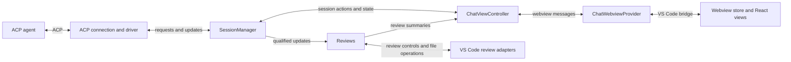

# Your Turn architecture

Your Turn is a VS Code extension that connects to ACP agents, shows their
sessions in the chat view, and lets users review agent edits in the editor.
This guide shows where to start when making a change. See
[AGENTS.md](AGENTS.md) for rules and
[GLOSSARY.md](GLOSSARY.md) for domain terms.

## How the parts fit

[`src/extension.ts`](src/extension.ts) delegates activation to
[`ExtensionActivation.ts`](src/adapters/ExtensionActivation.ts).
Activation constructs the core services and wires them to VS Code adapters.
The adapters handle VS Code APIs; core owns session and review behavior.

## Where to make changes

| If you are changing… | Start here |
| --- | --- |
| Agent launch, ACP negotiation, or protocol handling | [`AgentManager.ts`](src/core/AgentManager.ts) launches the process. [`ConnectionManager.ts`](src/core/acp/ConnectionManager.ts) negotiates and selects [`V1Driver.ts`](src/core/acp/V1Driver.ts) or [`V2Driver.ts`](src/core/acp/V2Driver.ts). |
| Session lifecycle, selection, or navigation | [`sessions/Manager.ts`](src/core/sessions/Manager.ts) owns connections, registrations, activity, and prompt dispatch. [`Commands.ts`](src/core/sessions/Commands.ts) and [`Tabs.ts`](src/core/sessions/Tabs.ts) own navigation workflows and tab state. For the Agents view, start at [`SessionTreeProvider.ts`](src/adapters/SessionTreeProvider.ts) and [`sessions/List.ts`](src/core/sessions/List.ts). |
| Transcript content, composer drafts, or queued prompts | [`sessions/States.ts`](src/core/sessions/States.ts) retains session data. [`sessions/Content.ts`](src/core/sessions/Content.ts) defines pure transcript transitions. [`sessions/Interactions.ts`](src/core/sessions/Interactions.ts) tracks observed requests and form drafts; connection-scoped handlers own request settlement. |
| Chat view rendering or message delivery | [`ChatViewController.ts`](src/core/ChatViewController.ts) sends transcript snapshots and patches through [`WebviewMessages.ts`](src/shared/WebviewMessages.ts). [`Main.tsx`](src/webview/Main.tsx) handles the webview bridge; [`RootState.ts`](src/webview/state/RootState.ts) routes updates to the selected or inspected transcript. React components live in [`webview/views/`](src/webview/views/). |
| Agent edit evidence, Keep/Undo, or native review UI | [`review/Reviews.ts`](src/core/review/Reviews.ts) owns shared pending files, session associations, and review decisions. `V1Guard` and `V2Guard` check agent reports. [`ReviewControls.ts`](src/core/review/ReviewControls.ts) coordinates presentation and decisions. [`adapters/review/`](src/adapters/review/) implements native editor, source control, and file operations. |
| Tool-call diffs or command output | Start with [`ToolCallDiffs.ts`](src/core/ToolCallDiffs.ts), [`AgentTerminals.ts`](src/core/AgentTerminals.ts), or [`CommandOutput.ts`](src/core/CommandOutput.ts). Reported diffs are historical, not the live Review Buffer. Terminal output is display-only. |

## Boundaries to preserve

- **Selection is not lifetime.** Multiple sessions can stay live across agents
  and on one connection. Selecting an already-live tab does not reload it.
  Identify a session by agent configuration name and session ID. Check the
  captured connection, registration, or content generation when applying
  delayed work. Load stages replay and commits it on success. Retained
  transcript content is in memory; the agent owns persistence.
- **Reading is not control.** The selected session owns the composer, queue,
  Prompt, and Stop. Inspection changes which transcript the user reads, not
  which session the user controls. A transcript address does not authorize
  commands. A child completion belongs only in its immediate parent's
  transcript.
- **The webview is a projection.** Core owns transcript content. The selected
  transcript and the currently inspected transcript use the same snapshot,
  patch, acknowledgment, and recovery path. Each address identifies the agent
  configuration, session, content generation, and projection instance. Each
  projection has its own revision and recovery state. The webview owns
  navigation, reading position, and focus. It uses no VS Code saved state and
  does not speak ACP. Only `ChatViewController` translates between core and the
  webview message contract.
- **Review has one decision authority.** `Reviews` shares pending files across
  sessions and orders evidence and observations per file. The session manager
  gates review resolution on workspace activity. Inspection stays available.
  Eligible live reports from confirmed descendants feed the root session's
  review. Keep the reporting session and connection separate from the review
  owner so reused tool call IDs cannot join reports from different sessions.
  Descendant inspection does not create a review. Load replay is not evidence.
  File and document effects go through the adapters; Git and file watchers do
  not supply agent edit evidence.

Use [`tests/AGENTS.md`](tests/AGENTS.md) to choose the test layer:
unit for core and reducer behavior, bundled webview for the message/rendering
boundary, integration for VS Code APIs, and desktop UI for workbench interaction.
