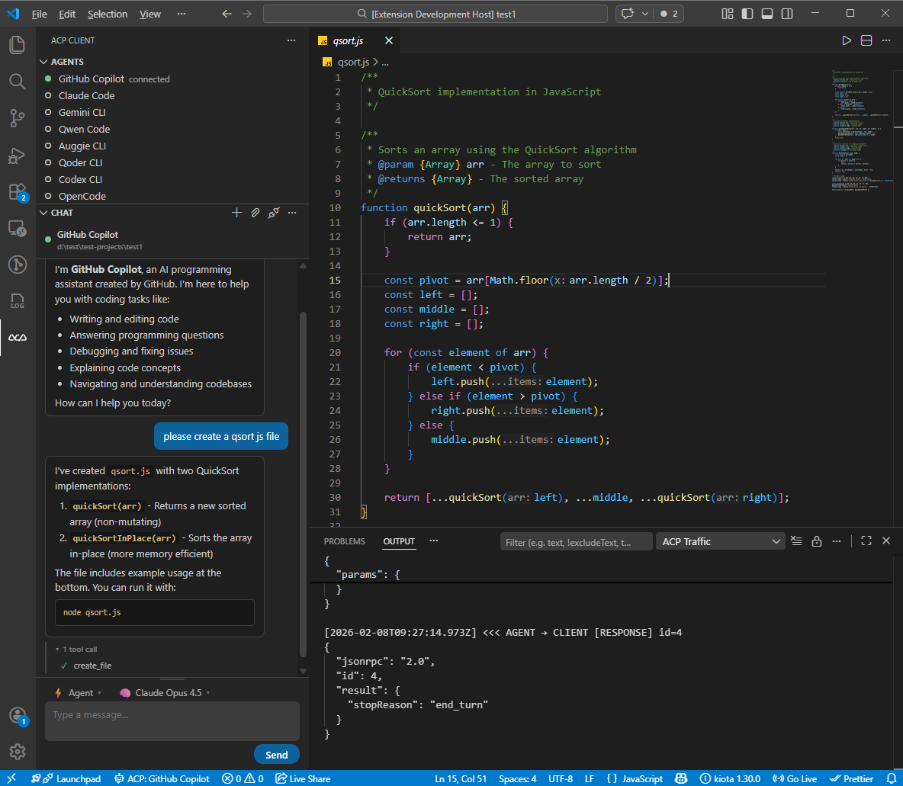

# ACP Client for VS Code

A [Visual Studio Code extension](https://marketplace.visualstudio.com/items?itemName=formulahendry.acp-client) that provides a client for the [Agent Client Protocol (ACP)](https://agentclientprotocol.com/) — connect to any ACP-compatible AI coding agent directly from your editor.



## Features

- **Multi-Agent Support**: Connect to any ACP agent you configure
- **Single-Agent Focus**: One agent active at a time — seamlessly switch between agents
- **Per-Agent Session List**: Each agent in the Agents view is expandable into its previous sessions. Click a session to restore its history in the chat. Backed by `session/list` when the agent supports it, or by a local per-workspace cache otherwise.
- **Session Config Options**: Dynamic per-session selectors (mode, model, reasoning level, …) advertised by the agent are rendered automatically in the composer toolbar.
- **Interactive Chat**: Built-in chat panel with Markdown rendering, inline tool call display, and collapsible tool sections
- **Thinking Display**: See agent reasoning in a collapsible block with streaming animation and elapsed time
- **Slash Commands**: Autocomplete popup for agent-provided commands with keyboard navigation
- **Mode & Model Picker**: Switch agent modes and models directly from the chat toolbar (kept for agents that haven't migrated to Session Config Options yet)
- **Permission Management**: Configurable auto-approve policies for agent actions
- **Protocol Traffic Export**: Retain recent ACP JSON-RPC messages in memory and export them as JSONL when requested
- **Agent Registry**: Add an agent from the ACP agent registry, run through `npx` or `uvx` at the version the registry lists
- **Chat Persistence**: Transcripts are preserved when switching panels

## Quick Start

1. Install: [Visual Studio Code Marketplace](https://marketplace.visualstudio.com/items?itemName=formulahendry.acp-client) | [Open in VS Code](https://vscode.dev/redirect?url=vscode%3Aextension%2Fformulahendry.acp-client) | [Open VSX Marketplace](https://open-vsx.org/extension/formulahendry/acp-client)
2. Open the ACP Client panel from the Activity Bar (ACP icon)
3. Click **+** to add an agent configuration
4. Click an agent to connect
5. Start chatting!

## Requirements

- Node.js 18+ (for spawning agent processes)
- An ACP-compatible agent installed or available via `npx`

## Adding an Agent

The extension comes with no agents configured. Add one with **ACP: Add Agent Configuration** (the **+** in the Agents view), which saves it to your user settings:

- **From the [ACP agent registry](https://github.com/agentclientprotocol/registry):** pick an agent that runs through `npx` or `uvx`, at the version the registry lists. Agents distributed only as a binary are listed but not added, as installing them is up to you; once installed, **ACP: Detect Agents** adds them. Having `npx` or `uvx` where VS Code finds it is up to you too.
- **Custom:** enter a name, the command that starts the agent in ACP mode, and its arguments.

**ACP: Detect Agents** looks on the `PATH` VS Code sees for the registry's agents distributed as a binary, and adds those you pick under the registry's names. It runs nothing to find them, so the version it shows is the registry's; yours may differ.

Or edit `acp.agents` in `settings.json` directly; for example, [OpenCode](https://opencode.ai) 2.x installed on your `PATH`:

```json
"acp.agents": {
  "OpenCode": { "command": "opencode", "args": ["acp"] }
}
```

Run through `npx` instead, the same agent is `"command": "npx", "args": ["@opencode/cli", "acp"]`. Each agent's own documentation gives its ACP command. Keeping an agent installed, up to date and signed in is up to you; the extension only starts it.

## Extension Settings

### Transcript images

Agent messages, thoughts, and tool text support inline and reference-style Markdown images.
PNG, JPEG, GIF, and WebP base64 data URIs render automatically after validation.
On Linux extension hosts, relative paths, contained absolute paths, and hostless `file:` URLs
load automatically from the originating session's working directory. Symlink targets must stay
inside that directory. Other platforms fail closed for local images until a race-resistant reader
is available. Existing files are eligible, not only files created by the agent.

HTTPS images require **Load image** for each occurrence. The approval shows the destination and
request origin. The extension host downloads the image, including on Remote-SSH; the browser never
receives the external URL as an image source. Only public HTTPS destinations are allowed, including
at most five validated redirects. HTTP, SVG, outside-directory paths, and arbitrary resource
providers are unsupported. Failures offer an explicit **Retry** where loading can be attempted again.

Each image is limited to 10 MiB, 16,384 pixels per dimension, and 40 million pixels. All displayed
images share a 50 MiB session payload budget. Successful images remain in memory without automatic
rereads or downloads. Replay, replacement, and session changes create new image lifetimes.
Header validation does not guarantee browser decoding or bound animation memory.

To tell an agent about these source forms, include explicit instructions such as:

> Use `` for raster images inside this session's working
> directory, or a base64 raster data URI. Public HTTPS raster images need my approval before loading.
> Do not use SVG, HTTP, or paths outside this session's directory. Keep each image under 10 MiB.

The extension does not inject these instructions or advertise a non-standard ACP capability.

| Setting | Default | Description |
|---------|---------|-------------|
| `acp.agents` | `{}` | Agent configurations. Each key is the agent name, value has `command`, `args`, and `env`. |
| `acp.autoApprovePermissions` | `ask` | How agent permission requests are handled: `ask` or `allowAll`. |
| `acp.defaultWorkingDirectory` | `""` | Default working directory for agent sessions. Empty uses current workspace. |
| `acp.logTraffic` | `true` | Capture ACP protocol traffic in memory for explicit JSONL export. Turning this off stops new captures but keeps traffic already retained until the extension host stops. |

## Commands

All commands are accessible via the Command Palette (`Ctrl+Shift+P`):

| Command | Description |
|---------|-------------|
| `ACP: Connect to Agent` | Connect to an agent |
| `ACP: New Session` | Start a new session with the connected agent |
| `ACP: Send Prompt` | Send a message to the agent |
| `ACP: Cancel Current Turn` | Cancel the current agent turn |
| `ACP: Disconnect Agent` | Disconnect from the current agent |
| `ACP: Restart Agent` | Restart the current agent process |
| `ACP: Open Chat View` | Focus the chat view |
| `ACP: Add Agent Configuration` | Add a new agent to settings |
| `ACP: Detect Agents` | Add agents from the ACP agent registry already installed on your `PATH` |
| `ACP: Remove Agent` | Remove an agent configuration |
| `ACP: Set Agent Mode` | Change the agent's operating mode |
| `ACP: Set Agent Model` | Change the agent's model |
| `ACP: Refresh Sessions` | Re-fetch the session list for an agent (also on the agent's right-click menu) |
| `ACP: Show Log` | Open the ACP Client log output channel |
| `ACP: Export Protocol Traffic` | Save the retained ACP protocol traffic as a JSONL file |

## Development

### Prerequisites

- Node.js 24 (`nvm use` reads `.nvmrc`)
- VS Code 1.140+

### Setup

```bash
git clone https://github.com/formulahendry/vscode-acp.git
cd vscode-acp
npm install
```

### Build & Run

```bash
npm run compile          # Development build: tsc type-checks, esbuild bundles the extension, webview, and integration suite
```

Press `F5` in VS Code to compile and launch the Extension Development Host. Development bundles carry source maps; `npm run build:production` minifies and leaves out the integration suite.

### Testing

All test and coverage commands first typecheck the repository, run ESLint,
and run Knip. A failed check stops execution. Required development bundles
are prepared once per batch; repeated runs stop on the first failure.

| Everyday command | Scope |
| --- | --- |
| `npm run check` | Typecheck, ESLint, and Knip; no build or tests |
| `npm test` | Unfiltered unit, webview, and VS Code integration gate; UI separate |
| `npm run test:unit` | Unit tests; no bundle build |
| `npm run test:webview` | Bundled-webview tests |
| `npm run test:in-process` | Unit and webview tests; no VS Code launch |
| `npm run test:integration` | Tests inside isolated VS Code instances |
| `npm run test:ui` | Separate desktop UI suite using Playwright |
| `npm run coverage` | Unit coverage; HTML in `test-results/unit/coverage/` |
| `npm run coverage:integration` | Per-job integration coverage in `test-results/integration/coverage/` |
| `npm run package:vsix` | Production build, then create the distributable VSIX |

Focused layer commands accept explicit source paths and `--repeat N`:

```bash
npm run test:unit -- tests/unit/core/AgentManager.test.ts --repeat 3
npm run test:integration -- --jobs 4 --display xvfb
```

Integration defaults to one worker. On Linux, `auto` display policy prefers
Xvfb, with an announced serial fallback to an inherited display if Xvfb is
unavailable. `xvfb` requires Xvfb; `existing` deliberately uses the inherited
display serially. The UI suite has separate Linux containment and Xvfb
prerequisites. Cross-platform test execution is not yet verified.

Optional, Git-ignored `.env.test.local` preferences control integration
(including integration inside `npm test`) and the separate UI suite:

```dotenv
TEST_JOBS=4
TEST_DISPLAY=xvfb
UI_JOBS=2
```

`TEST_JOBS` and `TEST_DISPLAY` affect integration only. `UI_JOBS` sets the UI
worker cap through Playwright's file-level scheduler; it must be a positive
integer. UI defaults to one worker and keeps retries disabled. Integration CLI
arguments override local preferences. CI ignores the local file.

### Lower-level checks and builds

| Command | Behavior |
| --- | --- |
| `npm run typecheck` | TypeScript typechecking only |
| `npm run lint` | ESLint and Knip only |
| `npm run compile` | Typecheck, then build development bundles; no lint or tests |
| `npm run build:production` | Typecheck, then build production bundles; no lint or tests |

`vscode:prepublish` is the packaging hook used by VSCE, not a separate
developer entry point. It invokes `build:production`.

### Packaging

```bash
npm run package:vsix     # Build production bundles and create .vsix
```

## Architecture

The extension follows a modular architecture:

- **Core**: `AgentManager`, `ConnectionManager`, `SessionManager`, `AcpClientImpl`
- **Handlers**: `PermissionRequests`, `SessionUpdateHandler`
- **UI**: `SessionTreeProvider`, `ChatWebviewProvider`, `StatusBarManager`
- **Config**: `AgentConfig`, `RegistryClient`
- **Utils**: `Logger`

Communication with agents uses the ACP protocol (JSON-RPC 2.0 over stdio).

## Known Issues

- Agents must be available via the system PATH or `npx`
- Some agents may require additional authentication setup
- File attachment feature is not yet functional

## Links

- [ACP Client on Visual Studio Code Marketplace](https://marketplace.visualstudio.com/items?itemName=formulahendry.acp-client)
- [Agent Client Protocol](https://agentclientprotocol.com/)
- [GitHub Repository](https://github.com/formulahendry/vscode-acp)

## Related Projects

- [ACP UI](https://github.com/formulahendry/acp-ui) — A modern, cross-platform desktop client for the Agent Client Protocol (ACP)
- [WeChat ACP](https://github.com/formulahendry/wechat-acp) — Bridge WeChat chat messages to any ACP-compatible AI agent (Claude, Codex, Copilot, Qwen, Gemini, OpenCode and more)

## License

MIT — see [LICENSE](LICENSE) for details.
